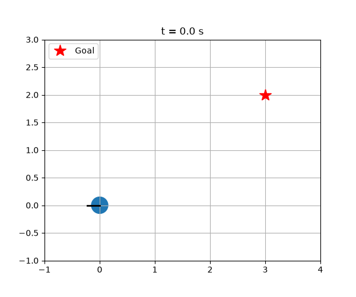

 Go-to-Goal Mobile Robot

A differential-drive robot that steers itself to a target point using a proportional (P) controller.

 How it works
Every 0.05 s the robot:
1. Measures the distance and direction to the goal
2. Sets its forward speed in proportion to the distance (slowing down as it arrives)
3. Turns in proportion to its heading error

## Findings
- A turning gain that is too low (e.g. 0.3) makes the robot orbit the goal forever.
- A faster robot needs a stronger turning gain to avoid overshooting.

## Run it
    pip install -r requirements.txt
    python robot.py      # plot the path
    python compare.py    # compare turning gains
    python animate.py    # watch it drive
    python -m pytest -v  # run the tests